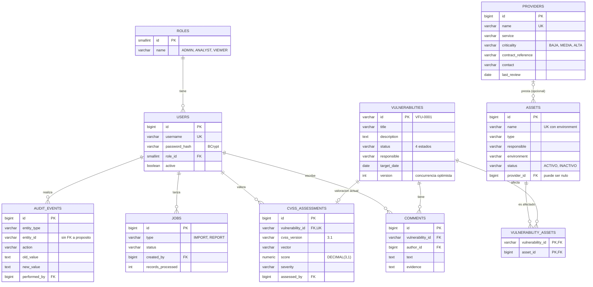

# Diagrama entidad-relación (T03)

Se ve dibujado en GitHub, en VS Code (extensión Mermaid) o pegándolo en <https://mermaid.live>.

## Estados de una vulnerabilidad

`ABIERTA` → `PENDIENTE_REMEDIACION` (exige responsable y fecha objetivo) → `RESUELTA` (exige evidencia: comentario) → `CERRADA`.
La base de datos garantiza que fuera de `ABIERTA` haya responsable y fecha. Las **transiciones permitidas** y la evidencia las valida la API (T09).

## Dónde se guarda cada dato del ejemplo VFU-0001

| Dato | Tabla y columna |
| --- | --- |
| Identificador, título, descripción, fecha de detección | `vulnerabilities.id / title / description / detected_at` |
| Estado, responsable, fecha objetivo, versión de edición | `vulnerabilities.status / responsible / target_date / version` |
| Afecta a "API de pagos" y "Servidor de Base de Datos Principal" | dos filas en `vulnerability_assets` (VFU-0001 con activo 1 y con activo 2) |
| Vector, puntuación 9,8 y severidad Crítica | `cvss_assessments.vector / score / severity` |
| Quién la valoró | `cvss_assessments.assessed_by` → `users` |
| Proveedor HostingSur de esos activos | `assets.provider_id` → `providers` |
| Comentarios y evidencias | `comments.text / evidence` |
| Quién cambió el estado y cuándo | `audit_events` |
